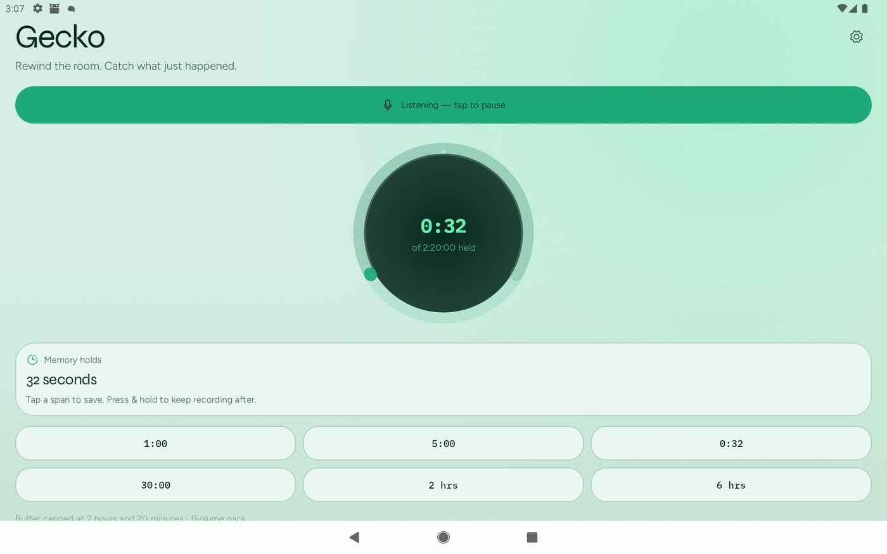
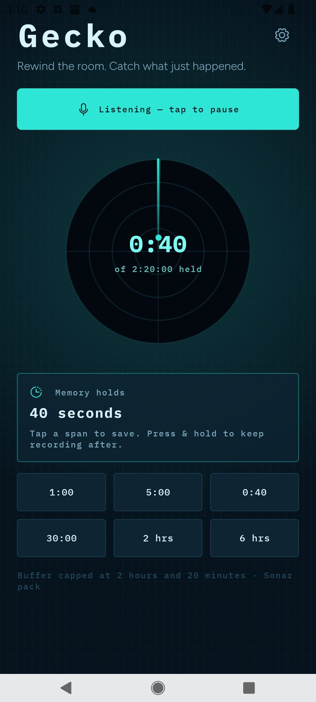
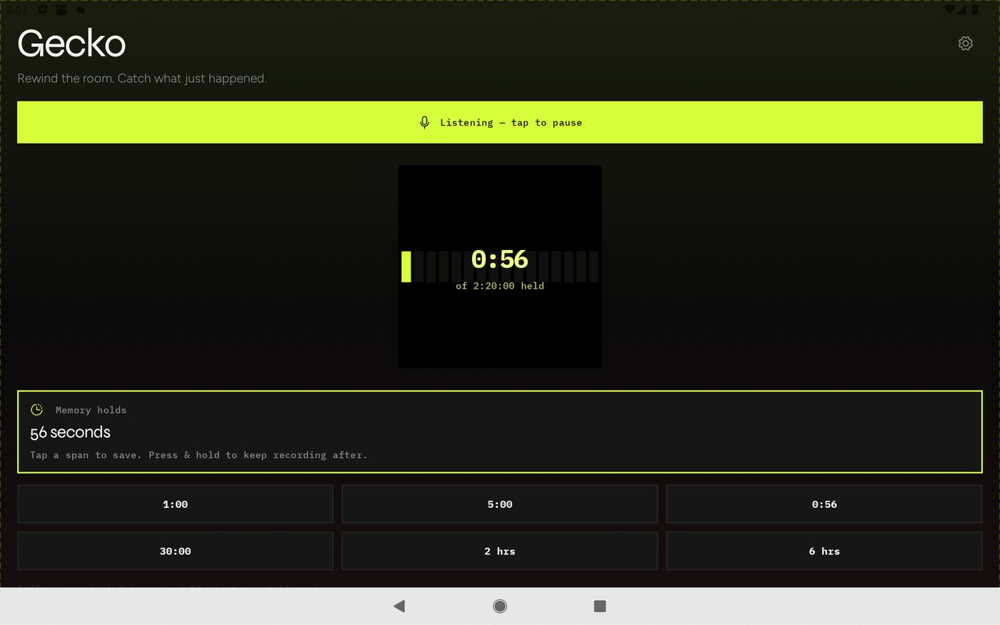
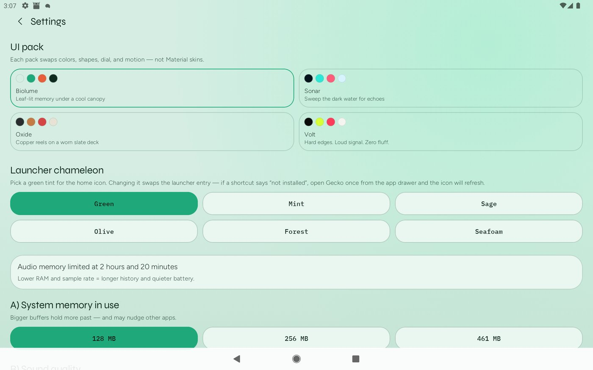

<p align="center">
  
</p>

<h1 align="center">Gecko</h1>

<p align="center">
  <strong>Rewind the room. Catch what just happened.</strong><br />
  Time-travelling audio recorder for Android — a rolling mic buffer so you can save the past, then optionally keep recording forward.
</p>

<p align="center">
  <a href="https://github.com/anantdark/Gecko/releases/latest"></a>
  &nbsp;
  <a href="https://f-droid.org/packages/com.anant.gecko/"></a>
</p>

<p align="center">
  <a href="https://anantdark.github.io/Gecko/"></a>
  <a href="https://github.com/anantdark/Gecko/actions/workflows/ci.yml"></a>
  <a href="https://github.com/anantdark/Gecko/actions/workflows/release.yml"></a>
  <a href="LICENSE"></a>
</p>

<p align="center">
  
  
  
  
</p>

## Download

| Channel | Link |
| --- | --- |
| **GitHub Releases** | [Latest APK](https://github.com/anantdark/Gecko/releases/latest) (`Gecko-latest.apk`) |
| **F-Droid** | [com.anant.gecko](https://f-droid.org/packages/com.anant.gecko/) |

Same package id on both channels. Prefer F-Droid for automatic updates; use GitHub for the newest signed build.

## What it does

Gecko listens into an in-memory ring buffer. When something worth keeping just happened, tap a duration chip to export the last N minutes (or everything held). Press-and-hold a chip to save history **and** keep recording forward.

- Continuous listening via a foreground mic service
- Save last 1 / 5 / 30 minutes, 2 / 6 hours, a custom span, or the full buffer
- UI packs, launcher icons, RAM budget, sample rate (8 / 16 / 44.1 kHz)
- WAV export to `Music/Gecko` via MediaStore
- Restarts after reboot if listening was left on
- No ads, no analytics — audio stays on-device

Inspired by [Echo](https://github.com/mafik/echo).

## UI packs

Custom composables (not Material skins). Each pack swaps colors, shapes, dial, surface, type, and motion.

| Pack | Feel |
| --- | --- |
| **Biolume** | Mint canopy, lichen glow |
| **Sonar** | Night ocean console |
| **Oxide** | Slate deck, copper |
| **Volt** | Ink void, acid chartreuse |

## Battery

Defaults favor clear speech without burning the battery:

| Choice | Why |
| --- | --- |
| **16 kHz** / **256 MB** buffer | Speech-clear; drop to 8 kHz for quieter battery |
| Power-saving mic mode | Platform favors battery over latency |
| 80 ms blocking reads | Fewer wakeups; saves still drain the HW buffer first |
| Quiet capture when UI unbound | No StateFlow spam in the background |
| Silent low-importance notification | No sound/vibration while listening |

Reliability: mic FGS, `START_STICKY`, boot receiver, swipe restart, pause-and-drain before every export.

## Build

Flavors: `github` (default releases) and `fdroid`. Needs JDK 17+ (CI uses 21), Android SDK 36.

```bash
./gradlew :app:assembleGithubDebug
./gradlew :app:installGithubDebug
```

Release signing: see [DISTRIBUTION.md](DISTRIBUTION.md).

```bash
./gradlew :app:assembleGithubRelease
```

## License

[GPL-3.0](LICENSE)