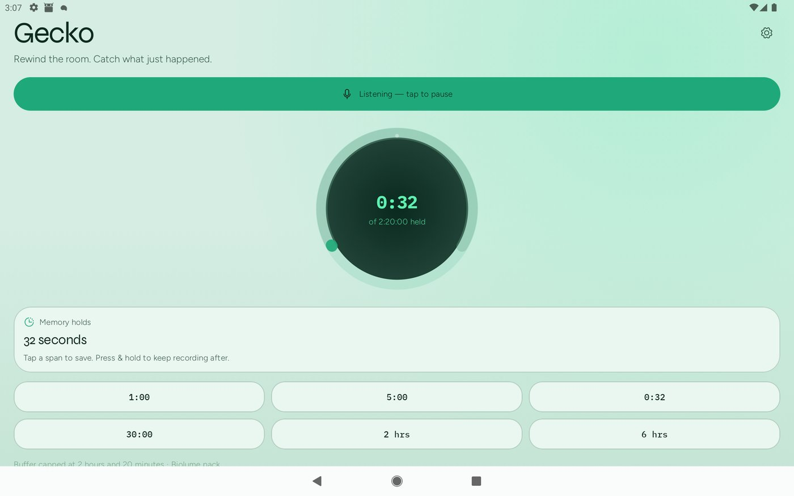
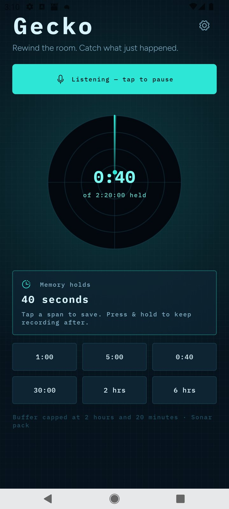
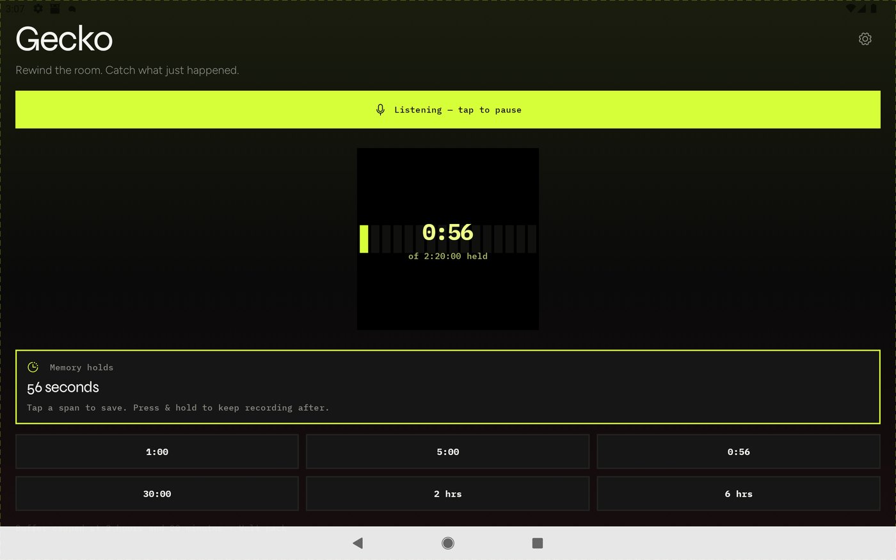
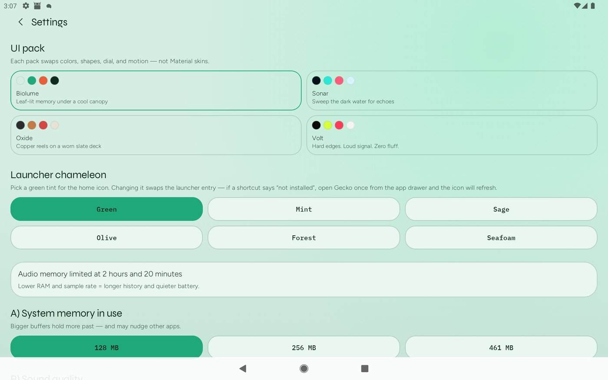

# Gecko

Time-travelling audio recorder for Android. Gecko keeps a rolling in-memory buffer of microphone audio so you can save something that *just* happened, then optionally keep recording forward.

Inspired by [Echo](https://github.com/mafik/echo).

[](https://github.com/anantdark/Gecko/actions/workflows/ci.yml)
[](https://github.com/anantdark/Gecko/actions/workflows/release.yml)
[](LICENSE)

## Screenshots

<p align="center">
  
  
  
  
</p>

## Features

- Continuous listening into a ring buffer (foreground mic service)
- Save the last 1 / 5 / 30 minutes, 2 / 6 hours, or everything held
- Press-and-hold a duration chip to save history **and** keep recording
- Settings for RAM budget and sample rate (8 / 16 / 44.1 kHz)
- Exports WAV files to `Music/Gecko` via MediaStore
- Restarts listening after reboot if it was left on

## Battery notes

Always-on listening is dominated by the mic + PCM copy path. Defaults favor battery without giving up durability:

| Choice | Why it helps |
| --- | --- |
| Default **8 kHz** | Speech-clear; ~⅙ the PCM of 48 kHz — raise in Settings if needed |
| `PERFORMANCE_MODE_POWER_SAVING` | Platform favors battery over latency for the mic path |
| Blocking reads in **80 ms** slices | Fewer sched wakeups; save still **drains** the HW buffer first |
| **No StateFlow publishes** while UI unbound | Capture runs quiet in the background |
| Larger HW buffer (×6 min) | HAL batches more audio per wakeup |
| Silent `IMPORTANCE_LOW` notification | No sound/vibration while listening |
| No AlarmManager on swipe | FGS + `stopWithTask=false` + sticky restart instead |

Background reliability: mic FGS, `START_STICKY`, boot receiver, swipe restart, pause-and-drain before every export.

## Build

Distribution flavors: `github` (default releases) and `fdroid`.

```bash
./gradlew :app:assembleGithubDebug
./gradlew :app:installGithubDebug
```

Release (needs local `keystore.properties` — see [DISTRIBUTION.md](DISTRIBUTION.md)):

```bash
./gradlew :app:assembleGithubRelease
```

Requires JDK 17+ (CI uses 21), Android SDK 36.

## UI packs (not Material skins)

Screens use custom composables in `ui/pack/` that read `LocalGeckoTheme` — no Material buttons/dialogs/scaffolds. Pick a pack in Settings; each swaps colors, shapes, dial, surface, type, and motion.

| Pack | Feel | Dial | Surface |
| --- | --- | --- | --- |
| **Biolume** | Mint canopy, lichen glow | Arc + breath | Soft leaf |
| **Sonar** | Night ocean console | Radar sweep | Glass + grid |
| **Oxide** | Slate deck, copper | Twin tape reels | Embossed metal |
| **Volt** | Ink void, acid chartreuse | Spectrum bars | Neon flat |

Icons: [Phosphor](https://phosphoricons.com) (MIT). Fonts: Syne, Figtree, IBM Plex Mono. See `app/src/main/assets/ATTRIBUTION.md`.

## License

[GPL-3.0](LICENSE)
